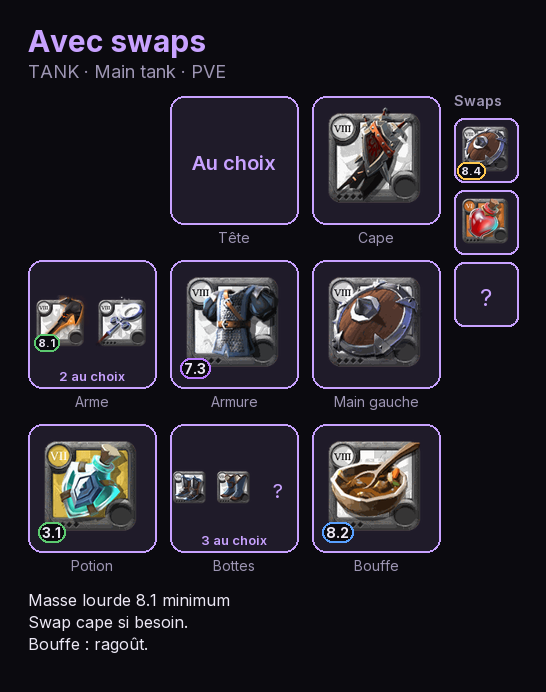
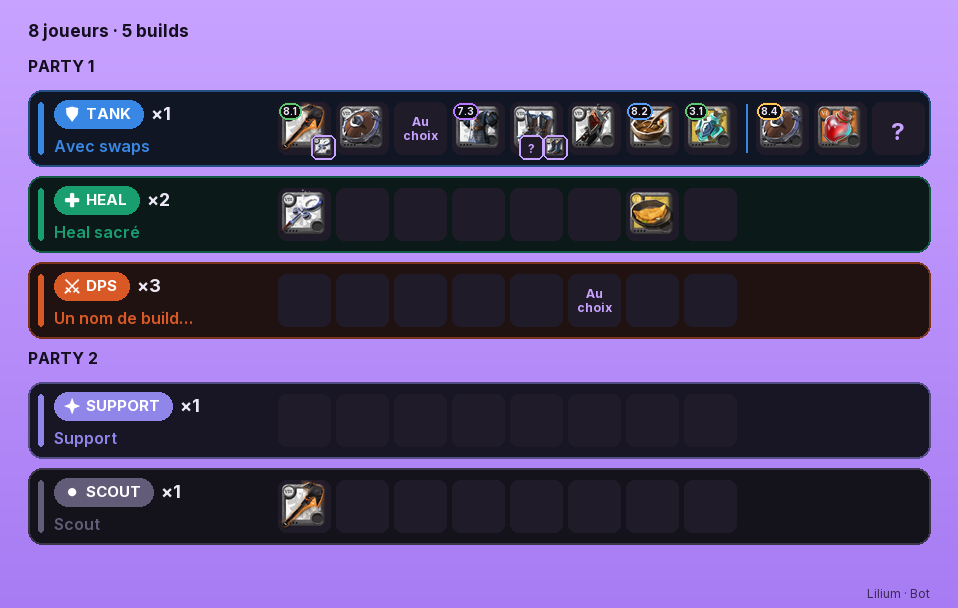

# AlbionCreateImageBuild

Génère des **images PNG de builds et de compos Albion Online** : la disposition de l'inventaire du jeu, les icônes officielles, la pastille de tier (8.1, 7.3…) à la couleur de l'enchantement, et les objets de rechange (swaps).

| Build | Compo |
|---|---|
|  |  |

- **Clé en main** : la police (Inter) et environ 290 icônes sont fournies dans le paquet. Si une icône manque, elle est récupérée sur le CDN officiel d'Albion.
- **Configurable** : couleurs (`Theme`), textes en français ou en anglais (`Labels`), rôles et leurs pictogrammes.
- **Testable** : le rendu est une fonction pure qui reçoit les icônes déjà téléchargées, donc aucun réseau n'est nécessaire dans les tests.
- **Robuste** : une erreur réseau ne fait jamais planter le rendu. Une icône absente, trop lente ou illisible est dessinée « ? ».

Dépendances : Pillow et aiohttp. Python 3.11 ou plus récent.

## Installation

```
pip install albion-create-image-build
```

Dans un `requirements.txt`, on fige la version : `albion-create-image-build==1.1.0`.

On peut aussi installer directement depuis un tag GitHub, sans passer par PyPI :
`albion-create-image-build @ https://github.com/NicolasDebras/AlbionCreateImageBuild/archive/refs/tags/v1.1.0.tar.gz`.

## Utilisation

```python
from albion_create_image_build import build_image, compo_image, CompoRow

build = {
    "name": "Heal sacré", "role": "HEAL", "type_acti": "PVP",
    "items": {
        "mainhand": ["T8_2H_HOLYSTAFF@1", "2H_HOLYSTAFF_HELL"],   # 2 choix possibles
        "head": ["HEAD_CLOTH_SET2"], "cape": ["*"],               # « * » = au choix du joueur
        "food": ["T8_MEAL_STEW@2"], "swaps": ["T7_OFF_SHIELD"],
    },
    "notes": "Purge sur les tanks.",
}

png = await build_image(build, signature="Ma guilde · MonBot")       # bytes PNG

png = await compo_image([
    CompoRow("Party 1", "TANK", 1, tank_build),
    CompoRow("Party 1", "HEAL", 2, build),
])                                                                   # None si aucune ligne
```

**Format des objets.** Chaque case contient de 1 à 3 ids au choix, au format du jeu :
- `T8_MAIN_SWORD@1` impose le tier 8 et l'enchantement .1 ;
- `MAIN_SWORD` laisse le tier libre ;
- `*` laisse le choix au joueur.

Les cases sont `mainhand`, `offhand`, `head`, `armor`, `shoes`, `cape`, `food`, `potion`, plus `swaps` (jusqu'à 6 objets de rechange). L'ancien format `{"mainhand": "ID"}` et une chaîne JSON sont aussi acceptés.

**Sorts (optionnel).** `spells` donne les sorts imposés, rangés par id d'objet **sans tier**. Les emplacements sont :
- `q`, `w`, `e` pour l'arme ;
- `a` pour l'actif d'armure (touche D, R ou F) ;
- `p` et `p2` pour les passifs.

Ils sont dessinés dans une section « Sorts » sous la grille. La clé `@shoes` impose un sort de bottes quand la case Bottes est vide ou `*` : le sort est alors dessiné dans la case. Les icônes viennent du CDN, sous les clés `spell:<ID>` du dict d'icônes.

```python
build["spells"] = {
    "2H_HOLYSTAFF": {"q": "HOLYBEAM", "p": "PASSIVE_HEALBONUS"},
    "@shoes": {"a": "SPRINT_CD_REDUCTION"},             # Sprint rafraîchissant, bottes au choix
}
```

### Sans réseau / avec vos propres icônes

```python
from albion_create_image_build import render_build_image, render_compo_image, item_ids, local_icon

icons = {i: local_icon(i) for i in item_ids(build["items"])}   # ou vos propres PNG
png = render_build_image(build, icons)
```

### Thème, langue, rôles

```python
from dataclasses import replace
from albion_create_image_build import Theme, Labels, DEFAULT_THEME

theme = Theme(
    background=(0, 0, 0), accent=(255, 80, 80), accent_dark=(180, 40, 40),
    role_order=("TANK", "HEAL", "SUPPORT", "DPS", "SCOUT"),
    role_colors={**DEFAULT_THEME.role_colors, "SCOUT": (240, 200, 0)},
    role_shapes={**DEFAULT_THEME.role_shapes, "SCOUT": "star"},   # swords, shield, cross, star, dot
)
png = render_build_image(build, icons, theme=theme, labels=Labels.EN)
labels = replace(Labels.EN, free_choice="Any")
```

Les rôles s'écrivent `"TANK"`, `"TANK · Main tank"` ou `"TANK 2"` : tous prennent la couleur de TANK. Un rôle inconnu prend une couleur neutre et une pastille ronde. `sort_rows(rows)` range les lignes d'une compo par party, puis selon `theme.role_order`.

### Téléchargement des icônes

```python
from albion_create_image_build import IconFetcher

fetcher = IconFetcher(concurrency=4, deadline=20)   # cache propre à cette instance
icons = await fetcher.fetch(["T8_MAIN_SWORD@1", "MEAL_STEW"])
png = await build_image(build, fetcher=fetcher)
```

Par défaut, un `IconFetcher` partagé par tout le processus est utilisé (`default_fetcher()`).

## Développement

```powershell
python -m venv .venv
.venv\Scripts\pip install -e ".[dev]"
.venv\Scripts\python -m pytest --cov
.venv\Scripts\ruff check .
```

Pour tester une modification dans un autre projet sans la publier, lancez `pip install -e ..\AlbionCreateImageBuild` dans le venv de ce projet.

Pour ajouter des icônes, partez d'un catalogue JSON `[{"id": "MAIN_SWORD", "icon": "T8_MAIN_SWORD"}, ...]` :

```powershell
.venv\Scripts\python scripts/download_icons.py --catalog ..\lilium-site\api\app\data\items.json
```

**Images de référence** (`tests/golden/`) : `test_golden.py` vérifie que le rendu par défaut ne change pas d'un pixel. Si une modification du rendu est voulue, régénérez-les avec `python tests/test_golden.py --update`, puis regardez les images avant de les committer.

## Publier une version

1. Faire la modification, avec un test, et vérifier que les tests passent.
2. Monter `__version__` dans `src/albion_create_image_build/__init__.py`, selon semver : correctif = patch, ajout = minor, changement de signature = major.
3. Commit, puis `git tag vX.Y.Z` et `git push origin main --tags`.
4. Le tag déclenche `.github/workflows/release.yml` : tests, vérification que le tag correspond à `__version__`, puis publication sur PyPI (Trusted Publishing, sans token).
5. Dans chaque projet qui utilise la lib, monter la version dans `requirements.txt`.

## Licence

Le code est sous licence MIT. La police Inter est sous licence SIL OFL 1.1. Les icônes d'objets sont © Sandbox Interactive (Albion Online).
